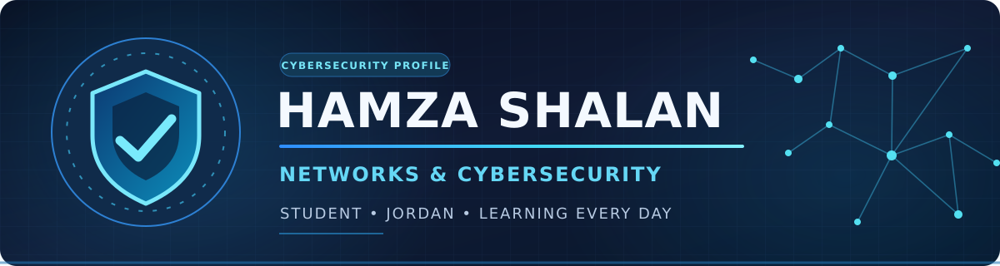

 

  <h3>👋 Welcome to My GitHub Profile!</h3>

  

  

    
    
    
  

---

## 🚀 About Me

---

## 🛡️ Cybersecurity Career Focus

  
  
  
  

- 🔵 **Blue Team:** Interested in defending systems and networks against cyber threats.
- 🔍 **SOC Operations:** Aspiring SOC Analyst focused on security monitoring, threat detection, and alert investigation.
- 🚨 **Incident Response:** Interested in incident investigation, containment, and recovery.
- 🌐 **Networking:** Building strong networking fundamentals with CCNA as a future certification goal.

---

- 🎓 I’m a **Networks & Cybersecurity Student**
- 🌍 I’m from **Jordan**
- 💡 Interested in **Networking, Cybersecurity, and Linux**
- 📚 Currently learning **Python, Git/GitHub, Networking, and Security**
- 🎯 My goal is to build strong practical skills and share my projects here on GitHub

---

## 🛠️ Languages and Tools

  

  
  
  
  

---

## 📊 GitHub Stats

  
  

  

  

---

## 🧠 Currently Learning

- Network Fundamentals
- Cybersecurity Basics
- Linux Commands
- Git & GitHub
- Python Basics

---

## 📌 Goals for This Year

- Build and upload useful projects
- Improve my networking and security skills
- Learn more Linux and Python
- Grow my GitHub profile and contributions

---

## 🌐 Connect With Me

  <!-- ضع رابط LinkedIn هنا لاحقاً إذا عملت حساب -->
  <!--  -->

---

  

